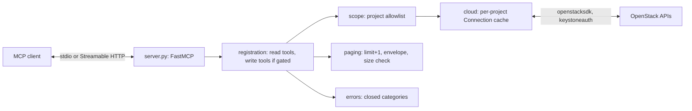

# Architecture

This repository implements an MCP server for OpenStack clouds. It started as
`openstack-kr/python-openstackmcp-server` at `eba3e6f` (see `NOTICE`) and is
being reshaped into a read-only-first server with a bounded, typed tool
surface. Behaviour is defined in [`docs/SPEC.md`](docs/SPEC.md); this file
describes how the code is organised to meet it.

Status: target layout for 0.1.0. Until the refactor lands, `src/` still has
the upstream layout (`tools/*_tools.py`, `tools/response/*`, module-level
`config.py`).

## Runtime flow

1. `__main__.main()` loads `Settings` from the environment. Invalid
   `OPENSTACK_MCP_*` values exit with code 2 (SPEC CFG-12).
2. `cloud.CloudConfig.load()` resolves credentials through openstacksdk's
   loader without network access and records whether the cloud is usable
   (CFG-3, CFG-7). A PEM CA from the environment is written to a private
   temporary file (CFG-6).
3. `server.build_server(settings, cloud)` creates the FastMCP instance with
   instructions, registers read tools, registers write tools only when both
   gates are open (RO-2), and registers prompts and resources unless disabled.
4. `main()` runs the selected transport.

## Modules

| Module | Responsibility |
| --- | --- |
| `config` | `Settings`: a frozen dataclass parsed and validated from `OPENSTACK_MCP_*`. No other module reads the environment, except openstacksdk's own loader. |
| `cloud` | Credential resolution, TLS source, project override (SCOPE-4), per-project `Connection` cache with fixed timeout and no retries. Takes a connection factory so tests inject fakes. |
| `scope` | Resolves the effective project for a call (SCOPE-2, SCOPE-3) before any authentication. |
| `paging` | `bounded(iterator, limit)` consumes at most `limit + 1` items; `ListResult[T]` builds the envelope; size check against the response limit (OUT). |
| `errors` | `ToolFailure(category)`; a single mapper from SDK and keystoneauth exceptions to categories with fixed messages (ERR). |
| `models/` | Pydantic response models per service, carried over from upstream `tools/response/` and extended with platform models. Field lists are explicit (OUT-6). |
| `tools/read/` | One module per service. Each function takes typed arguments, resolves scope, calls one SDK list/get operation, and returns a model or `ListResult`. |
| `tools/write/` | Upstream mutating operations, imported only when write tools are registered. |
| `registry` | Declares each tool once: name, title, annotations, function. Read and write tables are separate, which makes RO-1 a property of the table rather than of runtime checks. |
| `server` | Builds the FastMCP instance, instructions, tool/prompt/resource registration, call logging. |
| `logging` | stderr handler, level, SDK logger caps (LOG). |

## Boundaries

- Tool functions never receive a `Connection` from the caller. They ask
  `cloud` for the connection of the project chosen by `scope`.
- The SDK is called only through named proxy methods listed in the tool
  modules. There is no generic "call SDK method by name" path, so RO-3 and
  RO-4 hold by construction and are checked by tests with recording fakes.
- Errors cross the MCP boundary only as `ToolFailure`. Any other exception is
  mapped to `internal` and its text is logged at `DEBUG` without arguments.

## MCP framework

The server uses `FastMCP` from the official `mcp` Python SDK (1.x), as in
`nexus-mcp-server`. Return annotations produce `outputSchema` and
`structuredContent`; `ToolError` produces `isError` results. See
`DECISIONS.md` for why upstream's `fastmcp` package was replaced.

## Testing

- Unit tests use fake connections built from simple objects whose proxy
  methods are generators and record their calls.
- Protocol tests use the SDK's in-memory client session against
  `build_server(...)`, so annotations, schemas, `isError` and registration
  switches are tested as a client sees them.
- No test contacts a cloud or the network. The image smoke test in CI starts
  the container with environment-only settings and no credentials.

## Not implemented

- System-scoped or domain-scoped tokens; all sessions are project-scoped.
- Placement, Heat, Octavia, Swift, Manila and other services.
- Authentication on the HTTP transport.
- Caching of API results.
