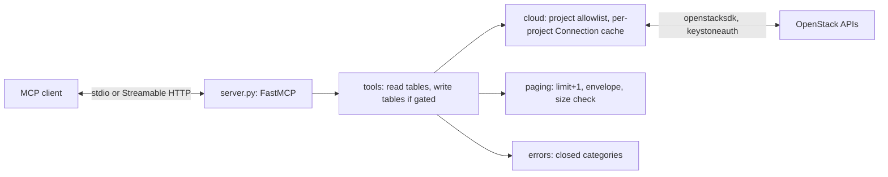

# Architecture

This repository implements an MCP server for OpenStack clouds. It started as
`openstack-kr/python-openstackmcp-server` at `eba3e6f` (see `NOTICE`) and was
reshaped into a read-only-first server with a bounded, typed tool surface.
Behaviour is defined in [`docs/SPEC.md`](docs/SPEC.md); this file describes
how the code is organised to meet it.

## Runtime flow

1. `__main__.main()` loads `Settings` from the environment. Invalid
   `OPENSTACK_MCP_*` values exit with code 2 (SPEC CFG-12).
2. `cloud.CloudConfig.load()` resolves credentials through openstacksdk's
   loader without network access and records whether the cloud is usable
   (CFG-3, CFG-7). A PEM CA from the environment is written to a private
   temporary file (CFG-6).
3. `server.build_server(settings, cloud)` creates the FastMCP instance with
   instructions, registers read tools, registers write tools only when both
   gates are open (RO-2), and registers prompts and resources unless disabled.
4. `main()` runs the selected transport.

## Modules

| Module | Responsibility |
| --- | --- |
| `config` | `Settings`: a frozen dataclass parsed and validated from `OPENSTACK_MCP_*`. No other module reads server settings from the environment. |
| `cloud` | `load_cloud()` resolves credentials through openstacksdk's loader (the only reader of `OS_*` and `clouds.yaml`), detects insecure transport and the TLS source. `CaBundle` writes the PEM CA file. `Cloud` resolves the project for a call before authentication (SCOPE-2, -3), builds a per-project configuration with fixed timeouts and no retries (SCOPE-4), caches connections, and checks the token's project. The connection factory is injectable for tests. |
| `paging` | `bounded()` consumes at most `limit + 1` items; `ListResult[T]` is the list envelope; `check_size()` enforces the byte limit (OUT). |
| `errors` | `ToolFailure(category)` and `classify()`, the single mapping from SDK, keystoneauth, requests and pydantic exceptions to categories with fixed messages (ERR). |
| `models/` | Pydantic result models per service, carried over from upstream `tools/response/` and extended with platform models. Unknown attributes are dropped (OUT-6). |
| `tools/base` | `Registrar`: shared argument fields (project, limit, marker), annotations, the call wrapper (worker thread, error mapping, size check, call log) and rejection of unknown arguments. |
| `tools/<service>` | `compute`, `image`, `block_storage`, `network`, `platform`. Each has `register_read(reg)` and, except `platform`, `register_write(reg)`. A tool resolves its connection through `Cloud`, makes one named SDK list/get (or, for writes, one mutating) call and returns a model or `ListResult`. |
| `tools/__init__` | `get_scope`, the scope document, and the read/write tables. Write modules are registered only when both gates are open, so RO-1 is a property of registration rather than a runtime check. |
| `server` | Builds the FastMCP instance with instructions, tools, and optional prompt and resource. |
| `log` | stderr handler, level, SDK logger caps (LOG). |
| `__main__` | Entry point: settings, logging, CA bundle, cloud, transport, signal handling. |

## Boundaries

- Tool functions never receive a `Connection` from the caller. They ask
  `Cloud` for the connection of the project it allows.
- The SDK is called only through named proxy methods listed in the tool
  modules. There is no generic "call SDK method by name" path, so RO-3 and
  RO-4 hold by construction and are checked by tests with recording fakes.
- Errors cross the MCP boundary only as `ToolFailure`. Any other exception is
  mapped to a category; only its type name is logged, at `DEBUG`.
- Tool functions are synchronous (the SDK blocks) and run in a worker thread,
  so one slow call does not stall other sessions on the HTTP transport.

## MCP framework

The server uses `FastMCP` from the official `mcp` Python SDK (1.x), as in
`nexus-mcp-server`. Return annotations produce `outputSchema` and
`structuredContent`; `ToolError` produces `isError` results. See
`DECISIONS.md` for why upstream's `fastmcp` package was replaced.

## Testing

- Unit tests use fake connections whose proxy methods record their calls and
  return counting generators, so tests can assert how many items were read.
- Protocol tests use the SDK's in-memory client session against
  `build_server(...)`, so annotations, schemas, `isError` and registration
  switches are tested as a client sees them.
- No test contacts a cloud or the network. The image smoke test in CI starts
  the container with environment-only settings and synthetic credentials.

## Not implemented

- System-scoped or domain-scoped tokens; all sessions are project-scoped.
- Placement, Heat, Octavia, Swift, Manila and other services.
- Authentication on the HTTP transport.
- Caching of API results.
