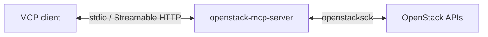

# openstack-mcp-server

> Community project, not affiliated with OpenStack/OpenInfra Foundation.
> Based on [openstack-kr/python-openstackmcp-server](https://github.com/openstack-kr/python-openstackmcp-server) at `eba3e6f` (Apache-2.0); see [NOTICE](NOTICE).

A [Model Context Protocol](https://modelcontextprotocol.io) server that lets AI
assistants inspect OpenStack clouds. It is read-only by default, bounded in
what it returns, and configured entirely through OpenStack's own settings and
environment variables, so it runs unchanged as a local process or a container.



## Features

- 32 read tools for compute, images, block storage, networking, the Keystone
  catalog and service inventory, plus `get_scope`.
- Write tools are not registered unless explicitly enabled by two settings.
- Project allowlist: each allowed project gets its own project-scoped session.
- Every list has `limit`, `complete` and `next_marker`; results are typed
  (`outputSchema`, `structuredContent`) and capped in size.
- Errors are `isError` results with a category and an action, without SDK
  messages, URLs or tokens.
- stdio by default; Streamable HTTP on loopback as an option.
- Container image without credentials, running as an unprivileged user.

The read-only mode is a convenience. **The security boundary is the Keystone
role of the identity you configure**; see [SECURITY.md](SECURITY.md).

## Quick start

### Container (Docker MCP Toolkit or any MCP client)

```bash
docker run --rm -i \
  -e OS_AUTH_URL=https://keystone.example.com:5000/v3 \
  -e OS_USERNAME=mcp-reader -e OS_PASSWORD \
  -e OS_USER_DOMAIN_NAME=Default -e OS_PROJECT_ID=0123456789abcdef0123456789abcdef \
  -e OS_REGION_NAME=RegionOne \
  ghcr.io/oomchiller/openstack-mcp-server@sha256:<digest>
```

Pin the image by digest; release digests are listed on the
[releases page](https://github.com/oomchiller/openstack-mcp-server/releases).
For a private CA, pass the certificate text in `OPENSTACK_MCP_CACERT_PEM`.

### Local process with clouds.yaml

```json
{
  "mcpServers": {
    "openstack": {
      "command": "uvx",
      "args": ["--from", "git+https://github.com/oomchiller/openstack-mcp-server@v0.1.0", "openstack-mcp-server"],
      "env": { "OS_CLOUD": "mycloud" }
    }
  }
}
```

`clouds.yaml` is found the usual way (`OS_CLIENT_CONFIG_FILE`,
`./clouds.yaml`, `~/.config/openstack/clouds.yaml`, `/etc/openstack/`).

## Configuration

Credentials come from openstacksdk: `OS_CLOUD` with `clouds.yaml`, or `OS_*`
variables (password or application credentials). Server behaviour:

| Variable | Default | Meaning |
| --- | --- | --- |
| `OPENSTACK_MCP_MODE` | `readonly` | `readonly` or `admin`. |
| `OPENSTACK_MCP_ENABLE_WRITE_TOOLS` | `false` | With `admin`, registers write tools. |
| `OPENSTACK_MCP_PROJECT_IDS` | empty | Comma-separated project IDs the server may use; the first is the default. |
| `OPENSTACK_MCP_DEFAULT_LIMIT` | `50` | Items per list call when `limit` is omitted. |
| `OPENSTACK_MCP_MAX_LIMIT` | `100` | Largest accepted `limit` (up to 1000). |
| `OPENSTACK_MCP_MAX_RESPONSE_BYTES` | `524288` | Largest result; larger ones fail with `response_too_large`. |
| `OPENSTACK_MCP_API_TIMEOUT` | `10` | Seconds per OpenStack request; no retries. |
| `OPENSTACK_MCP_CACERT_PEM` | unset | CA bundle as PEM text; takes precedence over `OS_CACERT`. |
| `OPENSTACK_MCP_ALLOW_INSECURE` | `false` | Allow `verify: false` or an `http://` auth URL. |
| `OPENSTACK_MCP_ENABLE_PROMPTS` | `true` | Register the prompt. |
| `OPENSTACK_MCP_ENABLE_RESOURCES` | `true` | Register `openstack://scope`. |
| `OPENSTACK_MCP_TRANSPORT` | `stdio` | `stdio` or `streamable-http`. |
| `OPENSTACK_MCP_HTTP_HOST` / `_PORT` | `127.0.0.1` / `8000` | HTTP bind; path `/mcp`. |
| `OPENSTACK_MCP_HTTP_ALLOW_REMOTE` | `false` | Allow a non-loopback HTTP bind. The HTTP transport has no authentication. |
| `OPENSTACK_MCP_LOG_LEVEL` | `WARNING` | stderr log level. SDK loggers stay at `CRITICAL`. |

An invalid `OPENSTACK_MCP_*` value stops the server with exit code 2 and
names the variable. Missing credentials do not: the server starts, and cloud
tools return `[not_configured]`.

Gateways that run several instances of this server and do not prefix prompt
names or resource URIs (Docker MCP Gateway) should set
`OPENSTACK_MCP_ENABLE_PROMPTS=false` and `OPENSTACK_MCP_ENABLE_RESOURCES=false`.

## Tools

| Group | Tools |
| --- | --- |
| Scope | `get_scope` |
| Compute | `list_servers`, `get_server`, `list_flavors` |
| Image | `list_images`, `get_image` |
| Block storage | `list_volumes`, `get_volume`, `list_volume_attachments`, `get_volume_attachment` |
| Network | `list_networks`, `get_network`, `list_subnets`, `get_subnet`, `list_ports`, `get_port`, `list_floating_ips`, `list_routers`, `get_router`, `list_router_interfaces`, `list_security_groups`, `get_security_group` |
| Identity | `list_regions`, `list_domains`, `list_projects`, `list_services`, `list_endpoints` |
| Service inventory | `list_hypervisors`, `list_compute_services`, `list_aggregates`, `list_network_agents`, `list_volume_services` |

Identity and service inventory usually need more than a project `reader`
role; such calls fail with `[forbidden]` rather than returning empty lists.

With `OPENSTACK_MCP_MODE=admin` and `OPENSTACK_MCP_ENABLE_WRITE_TOOLS=true`,
31 experimental write tools are added (servers, volumes, images, networks,
subnets, ports, floating IPs, routers, security groups). See
[docs/SPEC.md](docs/SPEC.md) for the full behaviour.

## Development

```bash
uv sync --locked
uv run pytest --cov
uv run ruff check . && uv run ruff format --check .
uv run mypy src tests
```

See [CONTRIBUTING.md](CONTRIBUTING.md), [ARCHITECTURE.md](ARCHITECTURE.md) and
[DECISIONS.md](DECISIONS.md).

## License

Apache License 2.0; see [LICENSE](LICENSE) and [NOTICE](NOTICE).
